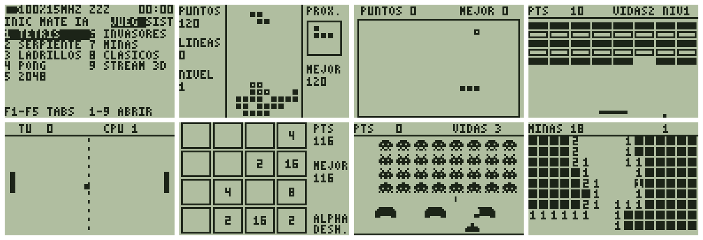

# Super-OS

**Un sistema operativo libre, hecho desde cero, para la TI-83 Plus Silver Edition** (Z80 a 15 MHz, 128 KB de RAM, 2 MB de flash), con un ESP32-S3 opcional en el puerto de enlace que le suma Wi-Fi, un chat con IA, un sistema de álgebra computacional y juegos en streaming.

[English](README.md) · [Instalar](docs/INSTALL.md) · [Juegos](docs/GAMES.md) · [Manual](docs/MANUAL.md) · [Estado](docs/STATUS.md)



> **Estado, con honestidad.** Super-OS es **alfa**. Se escribió y probó en un emulador y el 26/10/2026 arrancó por primera vez en una TI-83+ SE real (boot code 1.00, OS 1.19). Todo lo posterior a "arranca y muestra la pantalla de inicio" está verificado **solo en el emulador**; los problemas que aparecieron en la calculadora real justo después (teclado, juegos) están corregidos en esta versión pero **todavía no se volvieron a probar en la unidad**. El firmware del ESP32 nunca corrió en un chip. Instalar un OS puede dejar la calculadora inutilizable hasta reinstalar el oficial: leé primero [docs/INSTALL.md](docs/INSTALL.md), incluida la sección "la vuelta atrás".

## Qué trae

* **Un sistema operativo de verdad**: núcleo con multitarea, interfaz de 96x64 con dos fuentes, ES / EN, tres perfiles de batería, reposo profundo, reloj en tiempo real, ajustes guardados en flash, tienda de paquetes con instalación por aire y diagnósticos de hardware (LCD, teclado, RAM, flash, tiempos, enlace).
* **Siete juegos nativos** a pantalla completa, con récords, pausa y reposo: **Tetris, Snake, Breakout, Pong, 2048, Space Invaders y Buscaminas** ([guía](docs/GAMES.md)), más seis clásicos CHIP-8.
* **Herramientas científicas**: calculadora estilo TI con menú MATH, graficador 2D, conversor de unidades, tabla periódica y constantes físicas.
* **Con el ESP32-S3** (opcional): chat DeepSeek, **Super-CAS** (derivadas, integrales, límites, ecuaciones, matrices, gráficos 3D), Wikipedia, clima y juegos en streaming. Sin él todo lo demás funciona: las apps que lo necesitan avisan y CLEAR cancela la espera.

## Probalo en cinco minutos (emulador, sin flashear nada)

```
git clone https://github.com/azariellarocca1999/super-os && cd super-os
.\scripts\1_install_toolchains.ps1      # una vez: baja el ensamblador, el núcleo del emulador y las herramientas de firma (Windows + PowerShell)
.\scripts\2_build_all.ps1 -Test         # compila todo y corre toda la batería de pruebas
.\scripts\3_run_simulator_or_flash.ps1  # una ventana con la calculadora y un ESP32 virtual
```

## En una calculadora real

Bajá `SuperOS.8xu` de [Releases](../../releases) y seguí [docs/INSTALL.md](docs/INSTALL.md): hacé backup, tené a mano el OS oficial, ensayá la recuperación (sacar una pila, mantener DEL, volver a poner la pila) y mandá el archivo con la herramienta de OS de TI Connect.

## Licencia

[MIT](LICENSE). Proyecto independiente, sin relación con Texas Instruments. No incluye software de TI ni ROMs comerciales.
